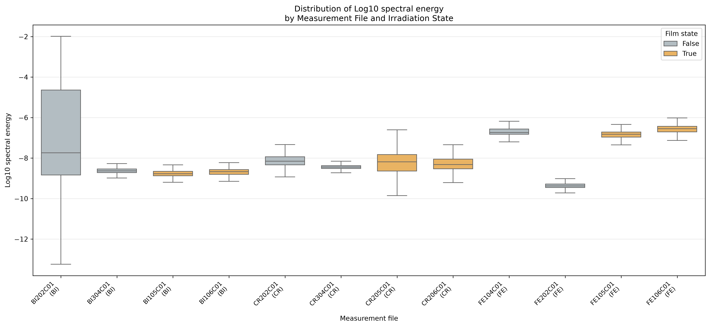
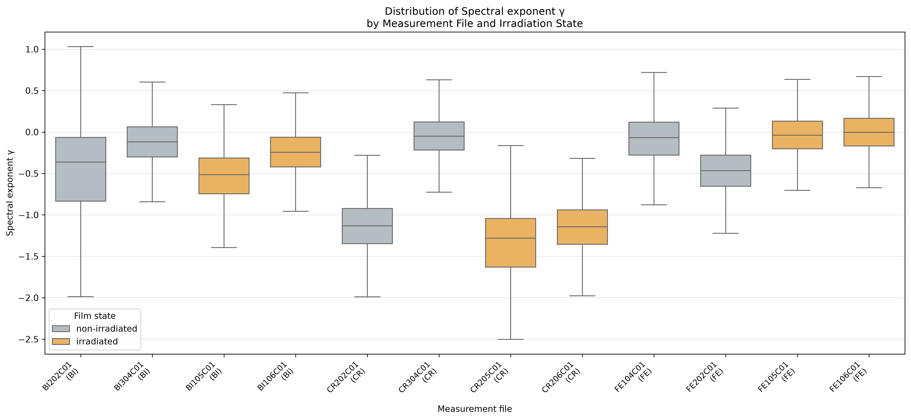
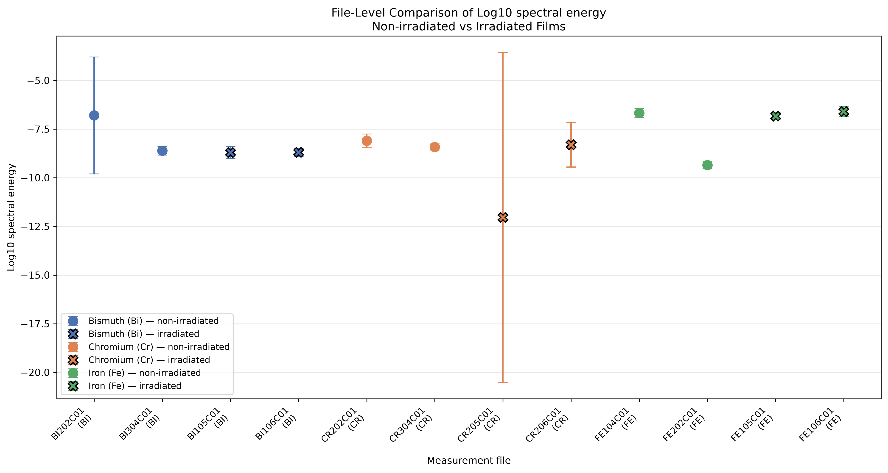
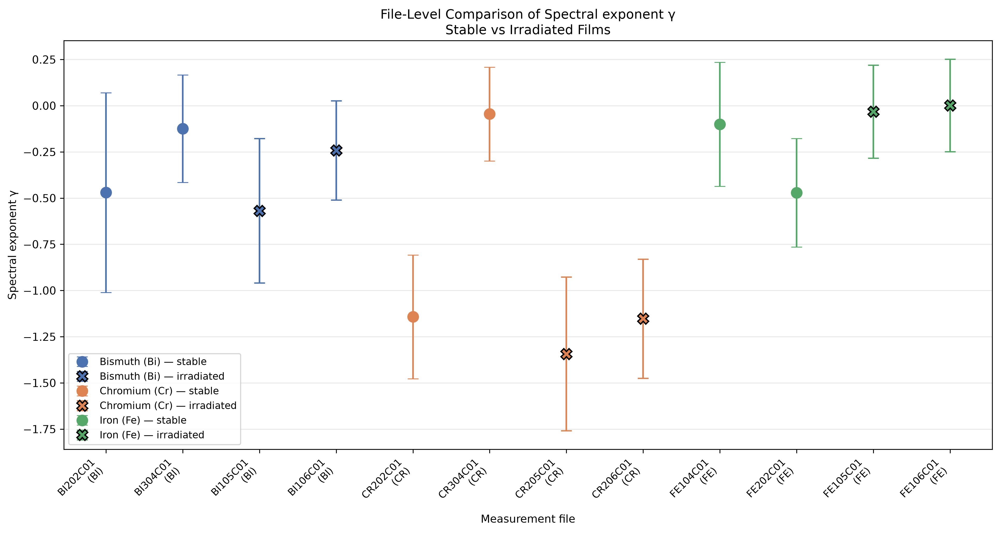
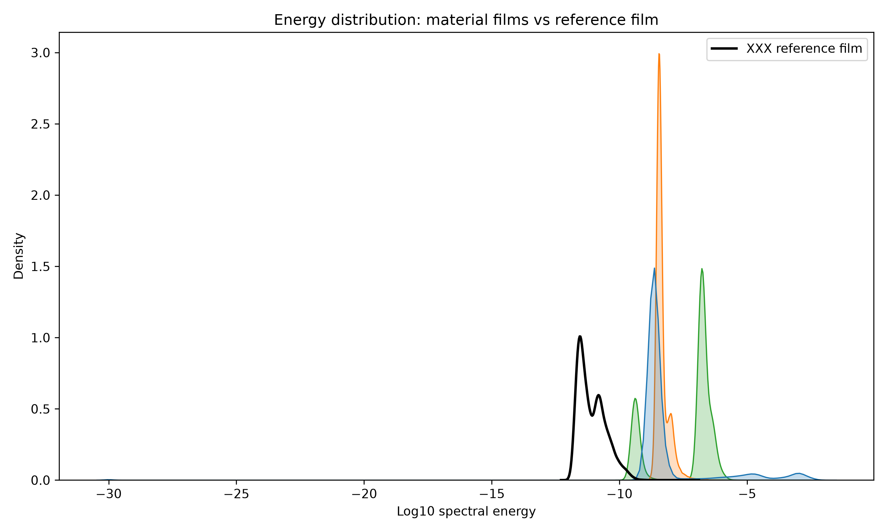
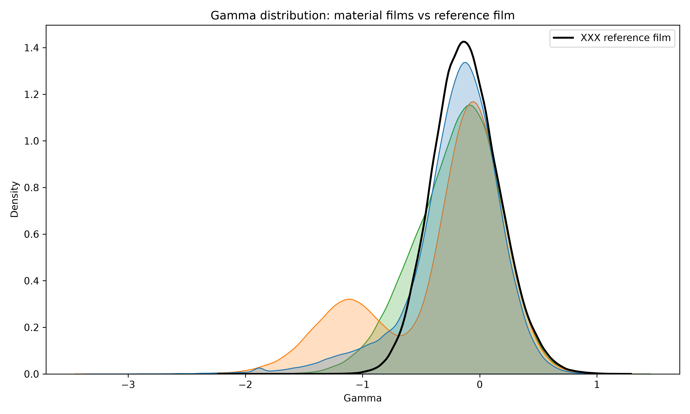
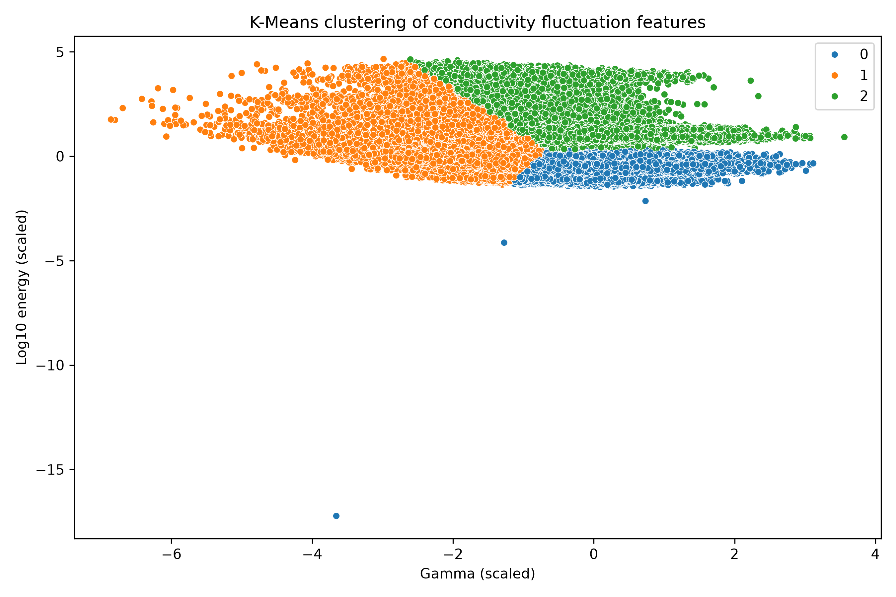
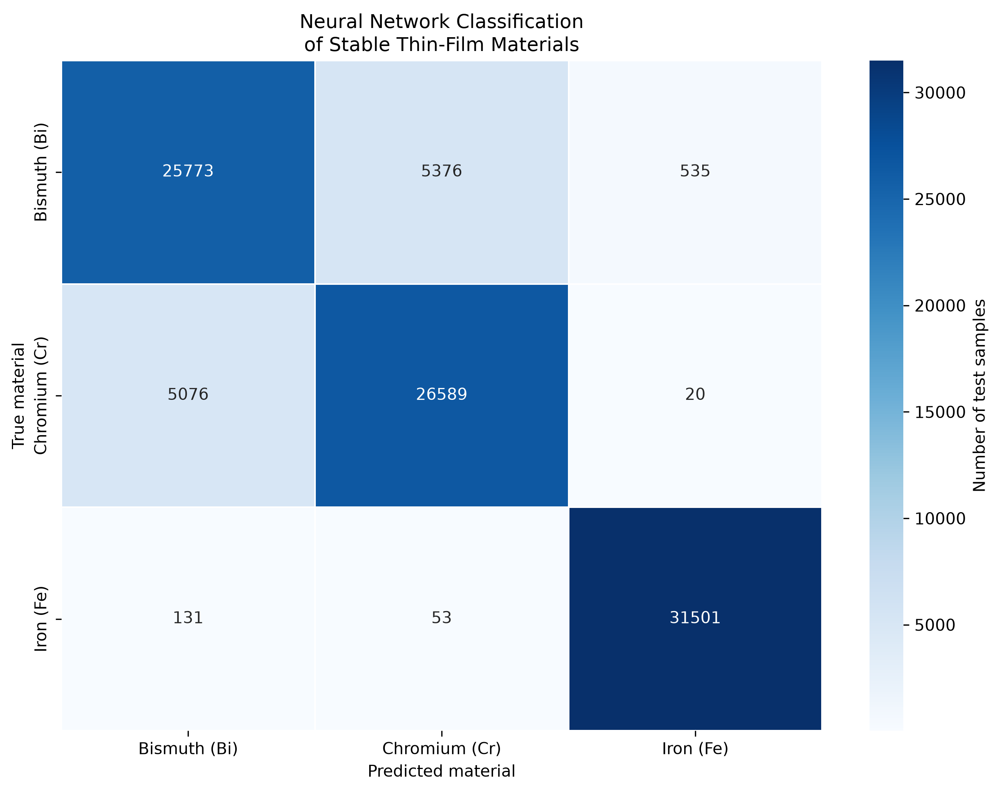

# Conductivity Fluctuation Analysis

This repository contains a Python pipeline for processing low-frequency
conductivity fluctuation measurements of thin metallic films and evaluating
machine-learning models for material recognition.

The workflow processes binary `.Q00` measurement files, extracts spectral features,
and evaluates K-Means clustering, K-Nearest Neighbors (KNN), and a fully connected
neural network.

Note: the accuracies below use a random sample-level split, as in the thesis.
For a stricter evaluation that keeps experimental series separate, see
[thin-film-noise-analysis](https://github.com/Katterina07/thin-film-noise-analysis)
(about 53% accuracy).

## Results

The following results were obtained using spectral features computed from the
conductivity fluctuation signals:

| Model | Metric | This repository | Result reported in the thesis |
|---|---:|---:|---:|
| K-Means | Silhouette score | 0.5098 | Qualitative cluster separation |
| K-Nearest Neighbors | Accuracy | **86.10%** | 86% |
| Fully connected neural network | Accuracy | **88.23%** | 89.41% |

The KNN result closely reproduces the result reported in the thesis. The difference from the thesis result is likely due to the different network configuration.

In the thesis, 89.41% accuracy was obtained with the neural network on spectral features.

## Figures

### Feature distributions by file





### File-level comparison





### Reference versus materials





### Clustering



### Neural network classification



## Data and features

The input data are binary `.Q00` files containing conductivity fluctuation
measurements for bismuth (Bi), chromium (Cr), and iron (Fe) thin films.
Reference measurements (`XXX`) were used to separate noise that is not related to
the chemical composition of the film; they are compared with the material
recordings in the "Reference versus materials" figures.

Both models use two features per 128-point window: `gamma` (spectral exponent) and
`log_energy` (log10 of mean spectral energy), standardized with a scaler fitted on the training set.

The spectral features are used for supervised material classification.

## Irradiated films
Irradiated films (210,137 windows per material) are not used for training. The trained network is applied to them;
predictions are saved to `results/metrics/irradiated_film_predictions.csv`. These predictions are not ground truth.

## Machine-learning models

- **K-Means clustering**: unsupervised analysis with `k = 3`. Silhouette score is computed on the training set (285,160 windows)
- **KNN**: supervised classification using spectral features.
- **Fully connected neural network**: supervised classification using spectral features.

The neural network is a scikit-learn `MLPClassifier` with hidden layers (64, 32),
ReLU activation, Adam optimizer (`alpha=1e-4`), early stopping and `random_state=42`.
The thesis describes a larger network (4 × 128, 100 epochs); this repository does not reproduce it exactly.

## Repository structure

```text
data/
  q00/                  Raw binary measurement files (not distributed)
  processed/            Extracted spectral features
notebooks/
  01_signal_processing.ipynb
  02_machine_learning.ipynb
results/
  figures/              Generated plots
  metrics/              Model metrics and prediction outputs
src/
  signal_processing.py  Q00 reading, calibration, sample extraction, features
  train_models.py       Spectral-feature model training and evaluation
```

## Requirements

- Python 3.10 or newer
- NumPy
- pandas
- SciPy
- scikit-learn
- Matplotlib
- Seaborn
- Jupyter / nbconvert

Install the dependencies:

```powershell
python -m venv .venv
.\.venv\Scripts\python.exe -m pip install -r requirements.txt
```

On macOS or Linux, use:

```bash
python -m venv .venv
source .venv/bin/activate
python -m pip install -r requirements.txt
```

## How to reproduce

Requires the raw Q00 files (not included), placed in data/q00/.

Run the signal-processing pipeline:

```bash
python src/signal_processing.py
```

Then execute and save the notebooks:

```bash
jupyter nbconvert --to notebook --execute --inplace notebooks/01_signal_processing.ipynb
jupyter nbconvert --to notebook --execute --inplace notebooks/02_machine_learning.ipynb
```

The notebooks generate figures, model metrics, and prediction outputs in the
`results/` directory.

## Data availability

Raw .Q00 measurement files are not included because they are unpublished
experimental results. Processed feature tables, model metrics, figures and
notebooks are provided to document the computational workflow.
The MIT license applies to the code only.

## Notes on evaluation

The reported KNN and neural-network accuracies use a random sample-level
train-test split, following the evaluation protocol of the original thesis.

Because the samples contain overlapping windows from the same measurement file,
this protocol can overestimate generalization to entirely unseen files. A
file-level leave-one-file-out evaluation of KNN using raw 128-point samples is
also included as a diagnostic result and shows substantially lower accuracy.

Therefore, the primary reproduced results are based on spectral features, while
raw-sample classification is treated as an additional exploratory analysis.

## Limitations

- The number of independent measurement files is limited: there are two files
  for each of the three studied materials.
- The reported neural-network result may vary between runs because of random
  weight initialization and training stochasticity.
- Raw 128-point conductivity samples do not generalize well across measurement
  files; spectral features are more suitable for the material-classification task.

Last full run: 10.2026.

## Citation

If you use this repository or its methodology, please cite the underlying
bachelor’s thesis:

> Chekalina, E. A. *Fluctuations of the Conductivity of Thin Metal Films*.
> South Ural State University, 2024.
